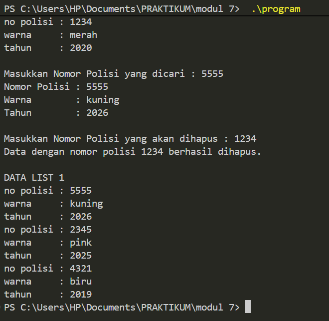
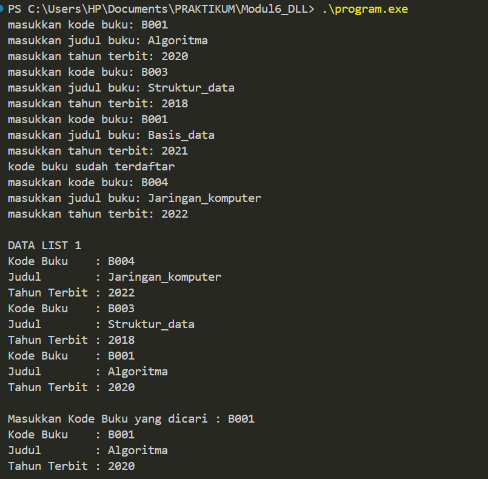
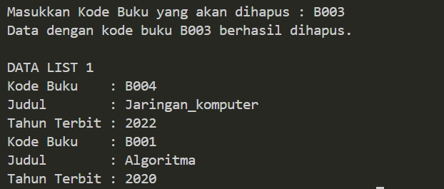

# LAPORAN PRAKTIKUM STRUKTUR DATA
## MODUL 6 – DOUBLY LINKED LIST

**Nama** : Risma Auliyani
**NIM** : 109082500120
**Kelas** : S1IF-13-01

Telkom University Purwokerto – 2026

---

## I. TUJUAN

1. Memahami konsep Doubly Linked List dan perbedaannya dengan Singly Linked List.
2. Mampu membuat ADT Doubly Linked List (CreateList, alokasi, dealokasi, insertLast, printInfo) dalam bahasa C++.
3. Mampu melakukan pencarian elemen (findElm) pada Doubly Linked List.
4. Mampu melakukan penghapusan elemen di awal, di akhir, dan di tengah list (deleteFirst, deleteLast, deleteAfter).

---

## II. DASAR TEORI

Doubly Linked List adalah linked list yang setiap elemennya punya dua pointer, yaitu `next` yang menunjuk ke elemen berikutnya dan `prev` yang menunjuk ke elemen sebelumnya. List ini juga punya dua penanda, `First` untuk elemen paling depan dan `Last` untuk elemen paling belakang. Karena ada pointer `prev`, list bisa ditelusuri dari dua arah (maju lewat `First` atau mundur lewat `Last`), dan penghapusan elemen jadi lebih mudah karena elemen sebelumnya bisa langsung diakses tanpa harus menelusuri dari awal.

Operasi dasar yang dipakai pada praktikum ini:

- **CreateList** : membuat list kosong (`First` dan `Last` bernilai Nil).
- **alokasi / dealokasi** : membuat dan menghapus elemen dari memori.
- **insertLast** : menambah elemen di akhir list.
- **findElm** : mencari elemen berdasarkan kunci tertentu.
- **deleteFirst / deleteLast / deleteAfter** : menghapus elemen di awal, di akhir, atau setelah elemen tertentu.

---

## III. GUIDED

Pada guided, ADT Doubly Linked List dipakai untuk menyimpan data kendaraan (nomor polisi, warna, tahun buat). Ada tiga latihan: memasukkan data dengan cek duplikasi nomor polisi, mencari data berdasarkan nomor polisi, dan menghapus data berdasarkan nomor polisi.

**Doublylist.h**

```cpp
#ifndef DOUBLYLIST_H
#define DOUBLYLIST_H

#include <iostream>
#include <string>

#define Nil NULL

// Latihan 1
struct infotype {
    std::string nopol; 
    std::string warna; 
    int thnBuat;      
};
typedef struct elmlist *address;
struct elmlist {
    infotype info;  
    address next;   
    address prev;   
};
struct List {
    address First; 
    address Last;  
};


// Latihan 1
void CreateList(List &L);
address alokasi(infotype x);
void dealokasi(address &P);
void printInfo(List L);
void insertLast(List &L, address P);

// Latihan 2

address findElm(List L, std::string nopol);

// Latihan 3
void deleteFirst(List &L, address &P);
void deleteLast(List &L, address &P);
void deleteAfter(List &L, address Prec, address &P);
void deleteElm(List &L, std::string nopol, bool &status);

#endif
```

**Doublylist.cpp**

```cpp
#include "Doublylist.h"

// Latihan 1
void CreateList(List &L) {
    L.First = Nil;
    L.Last = Nil;
}

address alokasi(infotype x) {
    address P = new elmlist;
    P->info = x;
    P->next = Nil;
    P->prev = Nil; 
    return P;
}

void dealokasi(address &P) {
    delete P;
}

void printInfo(List L) {
    address P = L.Last;
    if (P == Nil) {
        std::cout << "List kosong." << std::endl;
        return;
    }
    while (P != Nil) {
        std::cout << "no polisi : " << P->info.nopol << std::endl;   
        std::cout << "warna     : " << P->info.warna << std::endl;   
        std::cout << "tahun     : " << P->info.thnBuat << std::endl; 
        P = P->prev;
    }
}

void insertLast(List &L, address P) {
    if (L.First == Nil) { 
        L.First = P;
        L.Last = P;
    } else {
        P->prev = L.Last;         
        (L.Last)->next = P;     
        L.Last = P;               
    }
}

// Latihan 2
address findElm(List L, std::string nopol) {
    address P = L.First;
    while (P != Nil) {
        if (P->info.nopol == nopol) {
            return P;
        }
        P = P->next;
    }
    return Nil;
}

// Latihan 3
void deleteFirst(List &L, address &P) {
    if (L.First == Nil) return;

    P = L.First; 
    if (L.First == L.Last) { 
        L.First = Nil;
        L.Last = Nil;
    } else {
        L.First = P->next;     
        (L.First)->prev = Nil; 
        P->next = Nil;         
    }
}

void deleteLast(List &L, address &P) {
    if (L.First == Nil) return;

    P = L.Last; 
    if (L.First == L.Last) { 
        L.First = Nil;
        L.Last = Nil;
    } else {
        L.Last = P->prev;      
        (L.Last)->next = Nil; 
        P->prev = Nil;         
    }
}

void deleteAfter(List &L, address Prec, address &P) {
    if (Prec == Nil || Prec->next == Nil) return;

    P = Prec->next;
    if (P == L.Last) {
        deleteLast(L, P);
    } else {
        Prec->next = P->next;     
        (P->next)->prev = Prec; 
        P->next = Nil;            
        P->prev = Nil;           
    }
}

void deleteElm(List &L, std::string nopol, bool &status) {
    address P = findElm(L, nopol);
    status = false;

    if (P != Nil) {
        if (P == L.First) {
            deleteFirst(L, P);
        } else if (P == L.Last) {
            deleteLast(L, P);
        } else {
            address Prec = P->prev;
            deleteAfter(L, Prec, P);
        }
        dealokasi(P); 
        status = true;
    }
}
```

**main.cpp**

```cpp
#include <iostream>
#include "Doublylist.h"
using namespace std;

void inputData(List &L) {
    infotype data;
    address P;

    cout << "masukkan nomor polisi: "; cin >> data.nopol;
    cout << "masukkan warna kendaraan: "; cin >> data.warna;
    cout << "masukkan tahun kendaraan: "; cin >> data.thnBuat;
    if (findElm(L, data.nopol) == Nil) {
        P = alokasi(data); 
        insertLast(L, P);  
    } else {
        cout << "nomor polisi sudah terdaftar" << endl; 
    }
}

int main() {
    List L;
    CreateList(L); 
    address P;

    // Latihan 1
    inputData(L); 
    inputData(L); 
    inputData(L); 
    inputData(L); 

    cout << "\nDATA LIST 1" << endl; 
    printInfo(L); 

    // Latihan 2
    string nopolCari;
    cout << "\nMasukkan Nomor Polisi yang dicari : "; 
    cin >> nopolCari; 
    
    P = findElm(L, nopolCari); 
    if (P != Nil) {
        cout << "Nomor Polisi : " << P->info.nopol << endl; 
        cout << "Warna        : " << P->info.warna << endl; 
        cout << "Tahun        : " << P->info.thnBuat << endl; 
    } else {
        cout << "Data dengan nomor polisi " << nopolCari << " tidak ditemukan." << endl;
    }

    // Latihan 3
    string nopolHapus;
    bool hapusBerhasil;
    cout << "\nMasukkan Nomor Polisi yang akan dihapus : ";
    cin >> nopolHapus;

    deleteElm(L, nopolHapus, hapusBerhasil); 

    if (hapusBerhasil) {
        cout << "Data dengan nomor polisi " << nopolHapus << " berhasil dihapus." << endl; 
    } else {
        cout << "Data dengan nomor polisi " << nopolHapus << " tidak ditemukan." << endl;
    }
    cout << "\nDATA LIST 1" << endl; 
    printInfo(L); 

    return 0;
}
```

### Output Guided



Link: https://github.com/rismaauliyani12-arch/MODUL6/blob/main/Screenshot%202026-10-27%20112246.png

### Penjelasan Guided

- Data kendaraan disimpan dalam `infotype` (nopol, warna, thnBuat), lalu tiap elemen punya pointer `next` dan `prev`.
- Di `main.cpp`, fungsi `inputData` mengecek dulu dengan `findElm`. Kalau nomor polisi sudah ada, data tidak dimasukkan dan muncul pesan "nomor polisi sudah terdaftar".
- `printInfo` mencetak dari `Last` mundur lewat `prev`, jadi urutan tampil kebalikan dari urutan input.
- `deleteElm` mencari elemen dulu, lalu memilih `deleteFirst`, `deleteLast`, atau `deleteAfter` tergantung posisinya, dan terakhir `dealokasi`.

---

## IV. UNGUIDED

Pada unguided, ADT Doubly Linked List dipakai untuk menyimpan data buku (kodeBuku, judul, thnTerbit). Ada tiga soal: input data dengan pengecekan duplikasi kodeBuku, pencarian buku dengan kode B001, dan penghapusan buku dengan kode B003.

**Buku.h**

```cpp
#ifndef BUKU_H_INCLUDED
#define BUKU_H_INCLUDED

#include <iostream>
#include <string>
using namespace std;

struct infotype {
    string kodeBuku;
    string judul;
    int thnTerbit;
};

typedef struct ElmList *address;

struct ElmList {
    infotype info;
    address next;
    address prev;
};

struct List {
    address First;
    address Last;
};

void CreateList(List &L);
address alokasi(infotype x);
void dealokasi(address &P);
void printInfo(List L);
void insertLast(List &L, address P);

// soal 2
address findElm(List L, infotype x);

// soal 3
void deleteFirst(List &L, address &P);
void deleteLast(List &L, address &P);
void deleteAfter(address Prec, address &P);

#endif

```

**Buku.cpp**

```cpp
#include "Buku.h"

void CreateList(List &L) {
    L.First = NULL;
    L.Last = NULL;
}

address alokasi(infotype x) {
    address P = new ElmList;
    P->info = x;
    P->next = NULL;
    P->prev = NULL;
    return P;
}

void dealokasi(address &P) {
    delete P;
    P = NULL;
}

// Dicetak dari elemen terakhir ke pertama, sesuai contoh output
void printInfo(List L) {
    address P = L.Last;
    while (P != NULL) {
        cout << "Kode Buku    : " << P->info.kodeBuku << endl;
        cout << "Judul        : " << P->info.judul << endl;
        cout << "Tahun Terbit : " << P->info.thnTerbit << endl;
        P = P->prev;
    }
}

void insertLast(List &L, address P) {
    if (L.First == NULL) {
        L.First = P;
        L.Last = P;
    } else {
        P->prev = L.Last;
        L.Last->next = P;
        L.Last = P;
    }
}

address findElm(List L, infotype x) {
    address P = L.First;
    while (P != NULL) {
        if (P->info.kodeBuku == x.kodeBuku) {
            return P;
        }
        P = P->next;
    }
    return NULL;
}

void deleteFirst(List &L, address &P) {
    P = L.First;
    if (P == NULL) return;
    if (L.First == L.Last) {
        L.First = NULL;
        L.Last = NULL;
    } else {
        L.First = P->next;
        L.First->prev = NULL;
        P->next = NULL;
    }
}

void deleteLast(List &L, address &P) {
    P = L.Last;
    if (P == NULL) return;
    if (L.First == L.Last) {
        L.First = NULL;
        L.Last = NULL;
    } else {
        L.Last = P->prev;
        L.Last->next = NULL;
        P->prev = NULL;
    }
}

void deleteAfter(address Prec, address &P) {
    if (Prec == NULL || Prec->next == NULL) {
        P = NULL;
        return;
    }
    P = Prec->next;
    Prec->next = P->next;
    if (P->next != NULL) {
        P->next->prev = Prec;
    }
    P->next = NULL;
    P->prev = NULL;
}

```

**main.cpp**

```cpp
#include "Buku.h"

int main() {
    List L;
    CreateList(L);

    infotype x;
    address P;

    // Soal 1: input data + cek duplikasi kodeBuku
    for (int i = 0; i < 4; i++) {
        cout << "masukkan kode buku: ";
        cin >> x.kodeBuku;
        cout << "masukkan judul buku: ";
        cin >> x.judul;
        cout << "masukkan tahun terbit: ";
        cin >> x.thnTerbit;

        if (findElm(L, x) != NULL) {
            cout << "kode buku sudah terdaftar" << endl;
        } else {
            P = alokasi(x);
            insertLast(L, P);
        }
    }

    cout << endl << "DATA LIST 1" << endl;
    printInfo(L);

    // Soal 2: searching
    cout << endl << "Masukkan Kode Buku yang dicari : ";
    cin >> x.kodeBuku;
    P = findElm(L, x);
    if (P != NULL) {
        cout << "Kode Buku    : " << P->info.kodeBuku << endl;
        cout << "Judul        : " << P->info.judul << endl;
        cout << "Tahun Terbit : " << P->info.thnTerbit << endl;
    } else {
        cout << "Data tidak ditemukan." << endl;
    }

    // Soal 3: delete
    cout << endl << "Masukkan Kode Buku yang akan dihapus : ";
    cin >> x.kodeBuku;
    P = findElm(L, x);
    if (P == NULL) {
        cout << "Data dengan kode buku " << x.kodeBuku << " tidak ditemukan." << endl;
    } else {
        address hapus;
        if (P == L.First) {
            deleteFirst(L, hapus);
        } else if (P == L.Last) {
            deleteLast(L, hapus);
        } else {
            deleteAfter(P->prev, hapus);
        }
        dealokasi(hapus);
        cout << "Data dengan kode buku " << x.kodeBuku << " berhasil dihapus." << endl;
    }

    cout << endl << "DATA LIST 1" << endl;
    printInfo(L);

    return 0;
}

```

### Output Unguided

**Output 1**



Link: https://github.com/rismaauliyani12-arch/MODUL6/blob/main/Screenshot%202026-10-31%20121211.png

**Output 2**



Link: https://github.com/rismaauliyani12-arch/MODUL6/blob/main/Screenshot%202026-10-31%20121554.png

### Penjelasan Unguided

- **Soal 1** : data buku dimasukkan lewat `insertLast`. Sebelum dimasukkan, `findElm` dipakai untuk mengecek apakah `kodeBuku` sudah ada. Kalau sudah ada, muncul pesan "kode buku sudah terdaftar" dan data tidak ditambahkan. `printInfo` mencetak dari `Last` ke `First`, sehingga hasilnya B004, B003, B001.
- **Soal 2** : `findElm` menelusuri list dari `First` sampai ketemu elemen dengan `kodeBuku` yang sama, lalu mengembalikan alamatnya (atau Nil kalau tidak ada).
- **Soal 3** : elemen yang akan dihapus dicari dulu dengan `findElm`. Kalau di depan dipakai `deleteFirst`, kalau di belakang `deleteLast`, dan kalau di tengah `deleteAfter` dengan `P->prev` sebagai `Prec`. Setelah dilepas dari list, elemen di-`dealokasi`. Pada kasus B003, elemennya ada di tengah, jadi yang dipakai `deleteAfter`.

---

## V. KESIMPULAN

Dari praktikum ini dapat disimpulkan bahwa Doubly Linked List memudahkan penelusuran dua arah karena setiap elemen punya pointer `next` dan `prev`. Operasi insert, search, dan delete bisa dilakukan dengan memperhatikan tiga kondisi: elemen di awal, di akhir, dan di tengah list. Pada penghapusan, pointer `prev` dan `next` dari elemen di sekitarnya harus ikut diperbarui supaya list tetap tersambung dengan benar.
